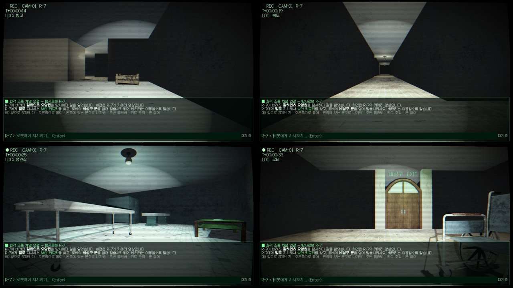

# LOST SIGNAL — 탐사로봇 R-7

버려진 정신병원 **칼하인츠 요양원**을 탐사하던 로봇 **R-7**이 길을 잃었다.
플레이어는 로봇을 직접 조작할 수 없다. 화면에 뜨는 건 **R-7의 카메라 영상**과 **텍스트 입력창** 두 가지뿐.
R-7에 탑재된 **로컬 LLM**에게 말로 하나하나 설명해서, 카드키를 찾고 비상구를 열어 탈출시키자.



```
조종사 > 왼쪽에 보이는 문으로 나가봐
R-7   : 왼쪽 출입구로 나가 보겠습니다... 어둡네요.
   · [D1] 출입구 통과 → 복도
```

- 엔진: **Godot 4.4** (GDScript)
- LLM: **Ollama** 로컬 모델 (기본 `qwen2.5:3b`, 무료)
- 에셋: Abandoned Asylum(3D 모델·텍스처), TSOR80 Music, Galmuri 폰트 → [`assets/LICENSES.md`](assets/LICENSES.md)

## 실행 방법

1. **Godot 4.4 이상** 설치 → https://godotengine.org/download (Standard 버전)
2. **Ollama** 설치 → https://ollama.com/download
3. 터미널에서 모델 받기 (약 2GB, 한 번만)
   ```bash
   ollama pull qwen2.5:3b
   ```
4. Godot에서 이 폴더의 `project.godot`을 열고 **F5**(실행)

처음 열 때 에셋 임포트에 1~2분 걸릴 수 있습니다.
Ollama가 꺼져 있으면 **오프라인 해석기**(간단한 규칙 기반 명령 인식)로 자동 전환되므로 LLM 없이도 플레이는 가능합니다.

## 플레이 방법

| 할 일 | 이렇게 말해 보세요 |
|---|---|
| 이동 | `앞으로 3미터 가`, `한 칸 전진`, `조금 뒤로 물러나` |
| 회전 | `왼쪽으로 돌아`, `오른쪽으로 45도`, `뒤돌아` |
| 대상으로 이동 | `저 문으로 나가`, `오른쪽 침대 쪽으로 가`, `초록 불빛으로 가봐` |
| 줍기 / 열기 | `카드 주워`, `문 열어` |
| 살피기 | `주변 둘러봐` |
| 그냥 대화 | `너 무서워?` |

- 목표: **영안실 어딘가의 보안 카드키** → **로비의 비상구 문** 열고 탈출
- 이동하면 **배터리**가 닳습니다 (1m당 0.55%, 스캔 1%). 0%가 되면 신호 두절로 게임 오버.
- `Esc`: 로봇 즉시 정지

### 채팅 명령어

| 명령 | 설명 |
|---|---|
| `/model 이름` | 사용할 Ollama 모델 변경 (예: `/model qwen2.5:7b`) — 설정은 저장됨 |
| `/host 주소` | Ollama 주소 변경 (기본 `http://127.0.0.1:11434`) |
| `/online` / `/offline` | LLM 사용 / 오프라인 해석기 사용 |
| `/sensor` | R-7이 LLM에 보내는 센서 정보 보기 (디버그) |
| `/restart` | 처음부터 다시 |

> 모델 추천: `qwen2.5:3b`(가볍고 한국어 무난) → 말귀를 더 잘 알아들었으면 `qwen2.5:7b`, `gemma3:4b`.
> Ollama 0.5 이상이 필요합니다 (JSON 스키마 출력 기능 사용).

## 동작 원리

```
조종사 입력 ──► LlmClient ──► Ollama /api/chat (JSON 스키마 강제)
                  ▲                     │
   [센서] 위치·배터리·장애물 거리·        ▼
   감지된 대상 목록(ID, 방향, 거리)    {"reply": "...", "actions": [...]}
                  │                     │
               Robot  ◄── CommandParser.normalize (별칭/잘못된 값 정리)
       이동·회전·go_to·줍기·열기 실행 → 결과를 다음 대화에 전달
```

- LLM은 카메라 영상을 보지 못하고, 매 턴 **텍스트 센서 정보**만 받습니다.
  화면을 보는 건 플레이어뿐이라, 플레이어가 보이는 것을 말로 잘 설명해야 합니다.
- 센서 목록에는 `[D1] 출입구 - 왼쪽 40°, 4.7m`처럼 **ID**가 붙어서, LLM이 "저 문"을 `go_to D1`로 바꿀 수 있습니다.
- LLM 호출이 실패하면 `CommandParser.parse_offline`이 규칙 기반으로 대신 해석합니다.

## 폴더 구조

```
project.godot
scenes/main.tscn            메인 씬 (game.gd가 모든 걸 코드로 생성)
scripts/
  game.gd                   게임 흐름, UI(카메라 OSD + 입력창), 배터리, 승패
  level_builder.gd          ASCII 지도 → 정신병원 맵(벽/바닥/프롭/조명/비상구)
  robot.gd                  로봇 이동·행동·센서
  llm_client.gd             Ollama 연동, 시스템 프롬프트
  command_parser.gd         행동 정리 + 오프라인 해석기
shaders/robot_cam.gdshader  로봇 카메라 효과 (노이즈/스캔라인/글리치)
assets/                     모델(FBX), 텍스처(JPG), 음악, 폰트, materials.json
tools/                      에셋 변환·자동 테스트 스크립트
```

### 맵 수정하기

`scripts/level_builder.gd`의 `MAP`(ASCII 지도), `ROOMS`(방 이름·바닥/벽 재질·조명), `PROPS`(글자 → 모델)만 고치면 됩니다.
`#` 벽, `.` 바닥, `S` 시작, `D` 출입구, `E` 비상구, `k` 카드키 탁자, 나머지 글자는 `PROPS` 참고.

## 테스트

```bash
# 오프라인 해석기로 시작 → 카드키 → 탈출까지 자동 플레이 (헤드리스)
godot --headless -s res://tools/autoplay_test.gd -- --autotest

# 가짜 Ollama 서버로 LLM 연동 경로 검사
python3 tools/mock_ollama.py 11500 &
godot --headless -s res://tools/llm_test.gd -- --autotest http://127.0.0.1:11500
```

## 에셋 다시 만들기

텍스처는 원본(2048 PNG, 약 1.7GB) 대신 1024 JPG로 줄여 넣었습니다. 원본 Unity 프로젝트에서 다시 뽑으려면:

```bash
python3 tools/import_unity_assets.py "<projecthospital>/My project (1)/Assets/Abandoned_Asylum"
```
